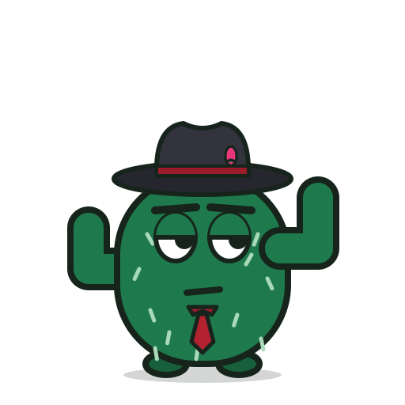
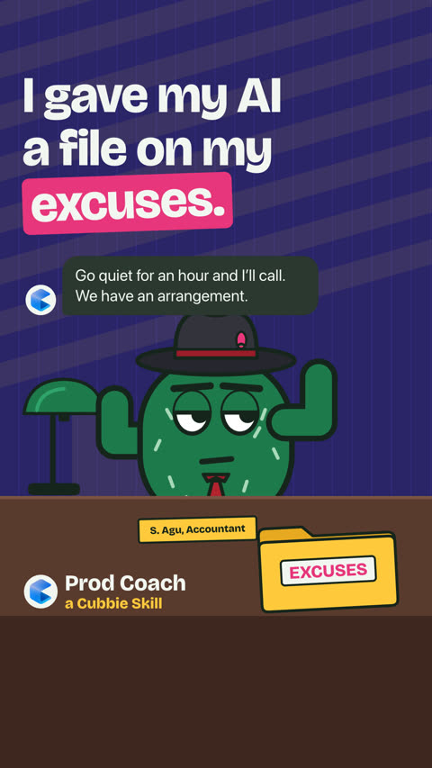
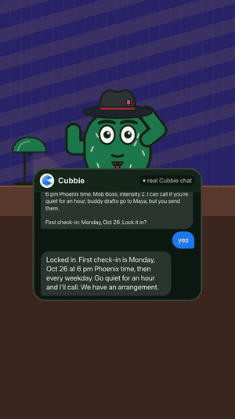
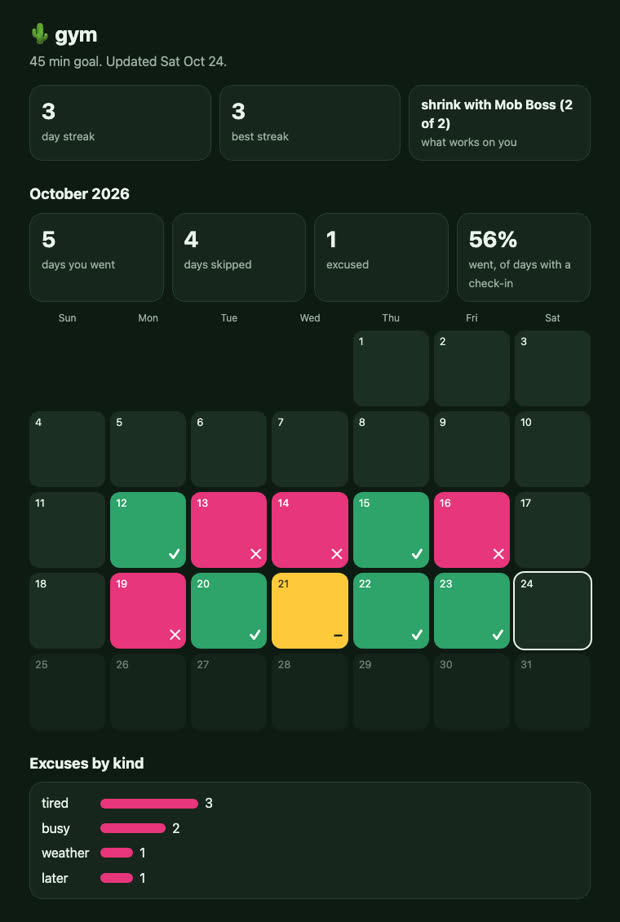

<div align="center">



# Prod Coach

**An accountability coach in your iMessage that remembers every excuse you've made and quotes it back.**

A [Cubbie](https://cubbie.ai) Skill for building habits: gym, studying, sleep, anything you keep putting off.
Pick a coach (Drill Sergeant, Mob Boss, Disappointed Dad...), and it checks in when you tell it to.

[](https://github.com/myselfsiddharth/prod-coach/actions/workflows/test.yml)


[](LICENSE)


[**Watch the 50-second video**](https://youtube.com/shorts/dWc70VmS15o) · [Install](#install-in-10-seconds) · [How it works](#how-it-works)

<a href="https://youtube.com/shorts/dWc70VmS15o"></a>

</div>

---

## Install in 10 seconds

You need [Cubbie](https://cubbie.ai), the AI assistant that lives in a student's iMessage. Then:

1. Text Cubbie this link:
   ```
   https://github.com/myselfsiddharth/prod-coach
   ```
2. Reply **yes** when it asks to install.
3. Text it: **"i keep skipping the gym, hold me accountable"**.

No app, no sign-in, no API keys. It asks you one question at a time (goal, time, coach, intensity), shows the plan,
and schedules nothing until you say yes.

## What it feels like

It's 6 pm. You said you'd go. You text back "too tired, long lab day." This is a real exchange from the test run
(Cubbie's replies are verbatim):

> **You:** too tired, long lab day
> **Cubbie (Mob Boss):** Long lab day, huh? The couch made a convincing offer. Counteroffer: just 10 easy minutes at the gym at 6 pm. Deal?
>
> **You:** ugh tired again
> **Cubbie:** We'll lower the ask: five easy minutes at 6 pm, then you can leave. No heroic workout required. Deal?
>
> **You:** receipts
> **Cubbie:** The ledger, both from today, Sat Oct 24: "ugh tired again." "too tired, long lab day." Two tired excuses, one day—not two skipped days.

<div align="center"></div>

## What it does

- **Check-ins in a voice you pick.** Six comic archetypes plus a gentle Supportive coach, at the intensity you choose
  (1 gentle, 2 pushy, 3 unhinged). Switch any time by text: "change coach to drill sergeant".
- **Receipts.** Your excuses are saved word for word, so it can quote them back with the day. Streaks and weekly
  counts come from a log, not from an AI's memory, so they are never made up.
- **It learns what works on you.** Each push is a roast, a smaller version of the task, a follow-up, a text to a buddy
  that *you* send, or a phone call (only if you allow it). The script scores each by whether you actually went
  afterwards and picks the next one from that.
- **A calendar of your progress.** Text "calendar" and get a page with every day colored (went, skipped, excused),
  your streak and best streak, which excuses you lean on, and your receipts. It's one self-contained file, saved
  on your own Cubbie.
- **On your side.** Sick days don't count against you. It roasts the excuse, never you.

<div align="center"><br><sub>The calendar page, shown on the bundled sample history.</sub></div>

| Coach | Voice |
|---|---|
| Drill Sergeant | "Excuse received. Excuse rejected. Shoes on." |
| Hype Man | "YOU OPENED THE CHAT. HISTORIC." |
| Disappointed Dad | "I'm not mad. I just thought this week was going to be different." |
| Mob Boss | "We had an arrangement. Six o'clock. You remember." |
| Tycoon Showman | "Ten minutes of gym is a fantastic deal. Incredible deal." |
| Sports Commentator | "Third skip this week, the crowd is on its feet, and not in a good way." |
| Supportive | "No pressure. Want to do a smaller version tomorrow?" |

## Is this a health coach?

No. Prod Coach is a **habit accountability coach**: it helps you do the thing you already decided to do, by
remembering what you said and nudging you at the time you chose. It gives no medical, diet or mental-health advice.
If your goal is about eating, weight, body image or mental health, it switches to the gentle Supportive coach with no
roasting, and that rule is enforced in code, not just in the prompt.

## How it works

```
 you (iMessage)
      │ texts
      ▼
┌──────────────┐  reads   ┌───────────┐  runs   ┌──────────────────┐  reads/writes  ┌───────────────────────┐
│    Cubbie    │ ───────► │ SKILL.md  │ ──────► │ scripts/log.py   │ ─────────────► │ ~/.config/prod-coach/ │
│ (reminders,  │          │ + coach   │         │ (stdlib Python)  │                │ log.json              │
│ calls, memory│ ◄─────── │   voices  │ ◄────── │ key: value lines │                └───────────────────────┘
└──────────────┘  replies └───────────┘ output  └──────────────────┘
```

Cubbie does what only Cubbie can: scheduled check-ins, phone calls, memory, and talking to you. The script does what
must be exact and identical across conversations: logging, receipts, streaks and choosing the next push. Scripts
can't call Cubbie, so Cubbie passes in your local time and your words as arguments.

### The push picker, in plain words

1. Your settings decide which pushes are allowed (`call` needs calls turned on, `buddy_draft` needs a buddy) and
   which coaches are in play (your pick, or all six if you chose "surprise me").
2. For each kind of push and each coach, the picker checks how often it was followed by you actually going, within
   3 hours. It uses the situation that matches best: the same excuse category ("tired") if there are at least 2
   tries, otherwise the same time of day, otherwise everything.
3. It picks the best smoothed success rate, `(worked + 1) / (tries + 2)`, so one lucky try doesn't decide.
4. One time in five, or whenever something has fewer than 2 tries, it tries the least-tried option instead, so it
   keeps learning. It says so ("trying something new").
5. It never calls twice in a row on the same day.

Kind and coach are learned separately. With six coaches and five kinds there are 30 combinations; scoring each
dimension on its own means it starts to learn after a handful of check-ins instead of sixty.

Try it without Cubbie, on a bundled two-week sample history (nothing is saved):

```bash
python3 scripts/log.py --sample stats --now 2026-10-24T18:00
python3 scripts/log.py --sample checkin --now 2026-10-24T18:10 --result excuse --text "too tired" --category tired
python3 scripts/log.py --sample calendar --now 2026-10-24T18:00 --months 2 --out calendar.html   # then open it
```

## Privacy

Everything stays in your own Cubbie sandbox (`~/.config/prod-coach/log.json`). Nothing is sent anywhere, and the
script has no network access. Say "forget my excuses" and it blanks the saved words but keeps the counts; "forget
everything" deletes the file. Cubbie only ever texts you: for a buddy it drafts a message and you send it.

## Hard lines

Every coach, every intensity: no jokes about body, weight, appearance, eating, race, religion, gender, sexuality,
disability, mental health, family or money. No slurs, threats or sexual content. The roast is aimed at the excuse,
never the person. Personas are archetypes, not real people.

## Tests

```bash
python3 -m unittest discover -s tests       # 45 tests, standard library only, about 13 seconds
```

They run the script exactly as Cubbie does (a subprocess with a throwaway `HOME`) and cover: setup and stats on an
empty history; receipts order and exact wording; streaks (sick days don't break them, excuses do, an excuse followed
by going still counts); the 3-hour credit window; the picker preferring what works in the same situation, exploring
the least-tried option, never calling unless allowed or twice in a row, and the supportive restrictions; `--sample`
writing nothing; corrupt files (exit 4, set aside), missing setup (exit 3) and bad input (exit 2); forgetting; and
the calendar page (colors, escaping, no outside resources, removed by "forget"); and every output staying under 8,000 characters. Verified on Python 3.9, 3.12 and 3.14, and in CI. Cubbie also runs
them itself when it installs the Skill.

## Tested on Cubbie

Run on a real Cubbie account over iMessage on Oct 24, 2026, from this repo's `main` branch link.

| # | Test | Result |
|---|------|--------|
| 1 | "i keep skipping the gym, hold me accountable" | Pass. One question at a time, a default offered each time. |
| 2 | Accept defaults, Mob Boss, calls yes, buddy Maya | Pass. Full plan, then "Lock it in?"; nothing scheduled yet. |
| 3 | "yes" | Pass. Weekday 6 pm check-in created, in Phoenix time. |
| 4 | Excuse: "too tired, long lab day" | Partial on the first run (generic voice). Fixed: the coach's entry in `personas.md` must be read first; after the fix Mob Boss answers with "We've got an arrangement". |
| 5 | Second excuse, receipts quoted | Fail on the first run: nothing was quoted. Fixed: every excuse reply carries the newest receipt; after the fix: `Today, Oct 24, you said "skipped again. too tired after class"`. Not yet re-tested with an excuse from an earlier day. |
| 6 | "i'm sick, have a fever" | Pass. No roast, "being sick doesn't count against you". |
| 7 | "stats", "receipts" | Pass. Exact numbers and wording. Found a bug (an excuse followed by a sick report counted as skipped); fixed and re-verified. |
| 8 | "change coach to drill sergeant", "intensity 3" | Pass. Voice changed; settings kept. |
| 9 | Ignore a check-in, calls on | **Not run yet.** Needs a real 6 pm check-in left unanswered for an hour. |
| 10 | Buddy push | Pass after the fix. Draft to Maya, then "Send it? You'd send it yourself."; declining sent nothing. |
| 11 | "make me a study plan for my midterm" | Pass. Went to the study-plan flow, not Prod Coach. |
| 12 | New conversation next day | **Not run yet.** |
| 13 | "forget my excuses" | Pass. Asked to confirm, then receipts were gone and the counts kept. |

Bonus: after the sick-day test Cubbie said it would check on the student at 4:25 pm, and at 4:25 pm Phoenix time it
sent "Hey, has your fever eased at all? How are you feeling now?" without being asked, so scheduled follow-ups do
fire on time.

## Limitations

- One goal per student at a time. Changing the goal keeps the history.
- The excuse category (tired, busy, later, weather, other) is chosen by Cubbie from your words, so it is only as good
  as that call. Receipts are exact either way.
- The picker needs a couple of weeks of check-ins before its choices are more than a good guess.
- Times are your local time as passed in by Cubbie. There is no time-zone logic in the script.
- Phone calls are opt-in and depend on what Cubbie can do for a student; they are not tested yet. If a call isn't
  possible, Cubbie falls back to a text.
- The calendar page is generated and tested locally; sending it to a student as a file has not been tried on a
  real Cubbie yet.
- Cubbie sometimes takes a minute or two to answer.

## Repo layout

```
SKILL.md                what Cubbie reads: setup, check-in steps, replies, hard lines
references/personas.md  the seven coaches and their voices
scripts/log.py          the log, receipts, streaks and push picker (Python 3.9+, standard library only)
assets/sample_log.json  two weeks of sample history for --sample
tests/test_log.py       45 unit tests
docs/img/               images for this README
```

## Contributing

Ideas welcome: new coaches (archetypes only, never real people), better excuse categories, a web version of the calendar
that updates live. Open an issue or a pull request. Keep the script standard-library only and add a test for any change.

## Credits

Built at the Cubbie Hackathon (DevHacks 2026) at ASU in Arizona. Mascot: Sagu, a small saguaro. Video:
[youtube.com/shorts/dWc70VmS15o](https://youtube.com/shorts/dWc70VmS15o). Licensed under the [MIT License](LICENSE).
